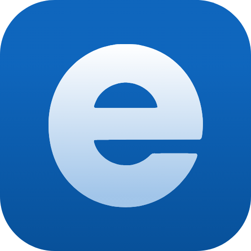

# eno.vn for Claude Code and Cursor



[eno.vn](https://eno.vn) is a marketplace for expats and internationals in Vietnam: housing, jobs, vehicles, services and second-hand goods. This plugin connects your coding agent to eno.vn's hosted MCP server, so it can run your shop for you: create and edit listings, put a whole catalogue online in one call, mark items sold, read views and leads, and manage webhooks.

The Claude Code plugin is in [`claude/`](claude) and the Cursor plugin in [`cursor/`](cursor).

## What you need

- A shop on eno.vn.
- A Partner API key for that shop. Create one on eno.vn under **Dashboard → Developers**. It starts with `eno_live_`.

The key stays on your machine. Claude Code keeps it in secure storage and Cursor in its plugin settings; it is sent only to `https://eno.vn/api/mcp` as a bearer token, and no tool ever takes it as an argument.

## Setup

**Claude Code:** install the plugin, then enter your API key when Claude Code asks for it:

```
/plugin install eno-vn --marketplace Soolking-cyber/eno-vn-plugin
```

**Cursor:** install the plugin, then open **Plugins → Configure** and set `ENO_API_KEY`.

## Tools

| Tool | What it does |
| --- | --- |
| `get_shop`, `update_shop` | Read or edit your storefront profile |
| `list_listings`, `get_listing` | Read your listings, any status |
| `create_listing`, `update_listing` | Post or edit one listing; public image URLs are re-hosted on eno.vn |
| `set_listing_status`, `delete_listing` | Put a listing on sale, mark it sold, hide it, or delete it |
| `bulk_create_listings` | Create up to 200 listings in one call |
| `sync_catalogue` | Keep eno.vn in step with your own system, matched by your own ids |
| `analytics_summary`, `analytics_listings` | Views and leads, for the shop and per listing per day |
| `list_webhooks`, `register_webhook`, `delete_webhook` | Get signed events when your listings change |

Each tool says whether it only reads or also changes your shop, so your agent can ask you before a change. Every action is limited to the one shop behind the key, and to the scopes the key was given.

Full reference: [eno.vn/developers/mcp](https://eno.vn/developers/mcp).

## Privacy

The plugin itself stores nothing and sends nothing anywhere except eno.vn. What eno.vn does with your shop's data is in its [privacy policy](https://eno.vn/privacy).

## Support

Email [support@eno.vn](mailto:support@eno.vn).
